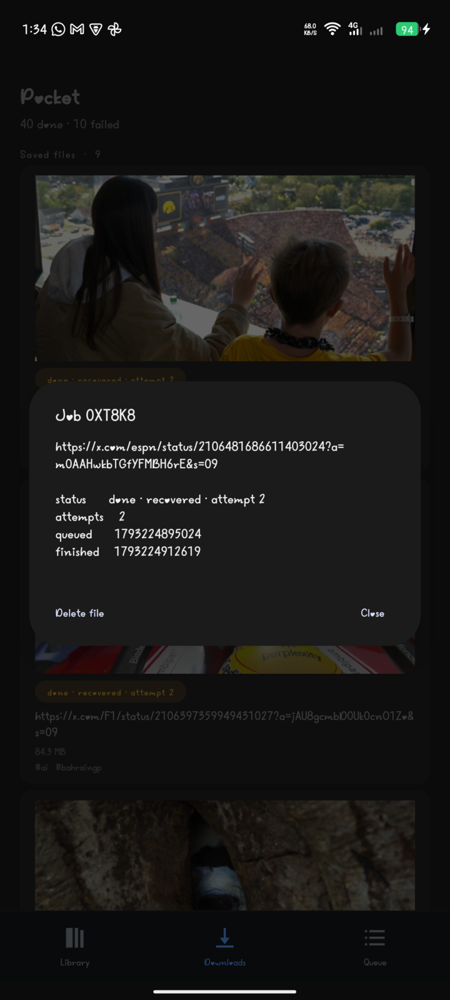
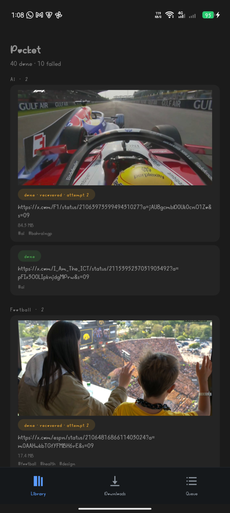
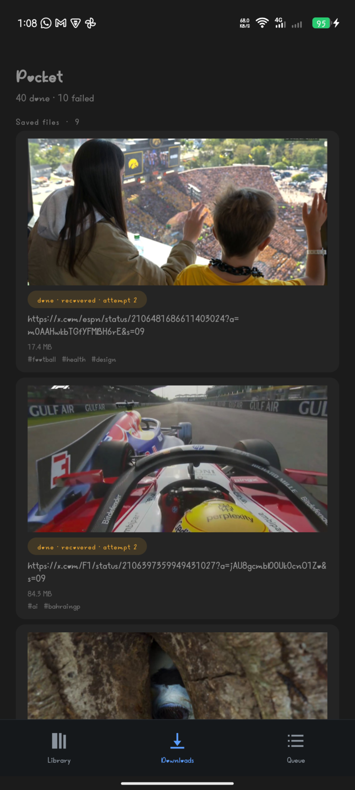
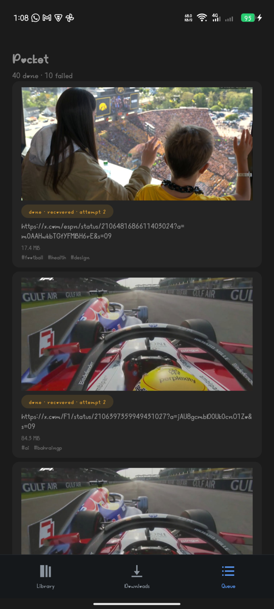

# Pocket

A tiny durable job queue that runs **inside an Android app**. Share text from any
app and a Rust worker — supervised by [Rivium](https://github.com/rivium-rs/rivium),
queued by [Apalis](https://github.com/apalis-dev/apalis) — describes it, then reports
back through a notification.

The same `App` runs on a laptop with `cargo run` and inside the phone. Nothing in the
queue code knows which host it is under.

The original challenge brief is preserved as [CHALLENGE.md](CHALLENGE.md).

## What it does

Share a snippet from Chrome, a note, anywhere:

```text
Share → Pocket  →  POST 127.0.0.1:8787/jobs  →  SQLite  →  worker  →  notification
```

The job is written to disk **before** any work starts, so closing the app, or the
system killing it, loses nothing. Reopen and the work finishes.

The job describes text — characters, words, distinct words and an FNV-1a hash so the same
text always gives the same fingerprint — or, when the shared text is a post link, it saves
that post as a video or as a card. One worker and one queue serve all three.

Rows carry their state: `done`, an amber `recovered · attempt N` when the process was
killed mid-job, and a red `failed` that records the reason instead of pretending to run.
Tapping a row opens the full result and offers to delete the file:



A finished text job arrives as a notification carrying **Copy hash** and **Share result**; a
saved post announces where the file went and offers **Share result**, as the recording below
shows.

[`docs/pocket-story.mp4`](docs/pocket-story.mp4) is one continuous recording on the phone,
with no cuts: the ESPN post open in the X app, Share, Share via…, Pocket, **Download the video**,
the queue showing that job as `running` straight away, Settings → Pocket → **Force stop** while it
is still transferring, reopening to find the same post as `running · recovered · attempt 2`, the
completion notification "Saved 17.4 MB to Downloads/Pocket", and that file at the top of Downloads
with the summary at "40 done".

## How it works

- **Rivium** owns the lifecycle. `src/app.rs` implements `App` and returns two
  supervised services: the HTTP listener on the `Frontline` tier and the worker on
  `Background`. Shutdown therefore stops accepting requests first, then drains the
  job in flight. Readiness is also the migration barrier: the worker service reports
  ready only after migrations and the `job_view` table exist, and the listener cannot
  serve until every service is ready.
- **Apalis** owns the queue. `apalis-sqlite` gives retries, scheduled jobs and orphan
  recovery. Two settings matter and both are in `src/queue.rs`: a **unique worker name
  per run**, and a **1.5 s heartbeat**. With a fixed name, apalis refuses to register
  the new worker (`WORKER_ALREADY_EXISTS`) and the dead run's job stays `running`
  forever.
- **The share sheet** is the Android feature. It posts to a loopback listener, because
  Rivium's JNI bridge deliberately exposes only start/stop/status/version — there is no
  "enqueue" call, and adding one would mean undocumented `unsafe` JNI. HTTP is also the
  reason the laptop path and the phone path are identical.

`job_view` is the app's own read model. The UI never reads Apalis's internal tables.

## Run it on a laptop

No phone needed.

```sh
cargo run -- --root target/pocket
```

```sh
curl -s localhost:8787/readyz                     # 200 once the queue is migrated
curl -s -X POST localhost:8787/jobs \
  -H 'content-type: application/json' \
  -d '{"text":"the quick brown fox jumps over the lazy dog"}'
curl -s localhost:8787/jobs/<id>
```

Real output, copied as-is:

```text
$ curl -s -o /dev/null -w '%{http_code}\n' localhost:8787/readyz
200

$ curl -s -X POST localhost:8787/jobs -H 'content-type: application/json' \
    -d '{"text":"the quick brown fox jumps over the lazy dog"}'
{"id":"01M60MVD49KFX9KCPJ6Q4KCKHH"}

$ curl -s localhost:8787/jobs/01M60MVD49KFX9KCPJ6Q4KCKHH
{"id":"01M60MVD49KFX9KCPJ6Q4KCKHH","text":"the quick brown fox jumps over the lazy dog","status":"done","attempts":1,"result":{"chars":43,"elapsed_ms":0,"hash":"7404cea13ff89bb0","unique_words":8,"words":9},"enqueued_at":1793170715785,"done_at":1793170715808}
```

`work_ms` is a debug knob that makes a job slow on purpose — useful for the tests
below. `--set lifecycle.stop_timeout=10s` raises the 3 s default shutdown grace;
without it, a job longer than 3 s is cut off instead of allowed to finish.

Ctrl-C with a 4 s job running:

```text
state before signal:  ('running', 1)
process exit code:    0
state after shutdown: ('done', 1)
residue:              none
```

### Why the worker name changes every run

`src/queue.rs` names each worker `pocket-<ulid>`. That is not decoration — it is what
makes a crashed run's job recoverable. The transcript below comes from a throwaway
harness that pushes a job and runs a worker over the same `src/queue.rs`; the app does
exactly this, with the name it generates. Same job, same database, only the name differs:

```text
$ ./negctl $DB work fixed            # first run, killed -9 after 3 s
worker pocket-fixed
   running|1

$ ./negctl $DB work fixed            # same name, restarting
worker pocket-fixed
Error: BackendError(PollNextError(Database(Io(Custom { kind: AlreadyExists, error: "WORKER_ALREADY_EXISTS" }))))
   running|1                         # after 8 s: still stuck

$ ./negctl $DB work                  # fresh name, as the app does
worker pocket-01M60MXS5W7NR55BBH1FFV1M9A
   recovered after 6s
   done|2
```

The dead worker's row is still in Apalis's `Workers` table, so the same name cannot
re-register. A fixed name therefore turns every crash into a permanently `running` job.

## Run it on a phone

Requires Rust 1.92+, JDK 21, Android SDK platform 36 and **NDK 28.1.13356709**, plus
`cargo-ndk 4.1.2`.

```sh
android/build-rust.sh          # cross-compiles libpocket.so for arm64-v8a and x86_64
cd android && ./gradlew installDebug
```

Open the app once so the host starts, then share text from any other app. The first
share works too: it retries until the host is ready, because a share can launch the
process before Rivium has finished starting.

Sharing is the only way work enters the app: select text anywhere, tap Share, pick
Pocket. There are deliberately no in-app buttons for creating jobs, because the point
is that another app starts the work.

```sh
adb forward tcp:8787 tcp:8787  # optional: poke the phone's queue from the laptop
curl -s localhost:8787/readyz
```

## Saving media from a link

On this branch a shared post link is more than text: the app asks what to do with it.

| Choice | What the worker does |
| --- | --- |
| **Download the video** | Resolves the post, takes the highest-bitrate stream, streams it to app storage, then publishes it to `Downloads/Pocket` |
| **Save a card image** | Fetches the post's public metadata and its images, then the app draws a card (1080x1350) and publishes it to `Downloads/Pocket` |
| **Just describe the text** | The original word/character job |

Transfers resume: bytes go to a `.part` file and a retry continues with a `Range`
request, so a dropped connection costs what was missed rather than the whole file.
Verified by killing the app mid-transfer — 3.5 MB on disk, relaunched, finished at
exactly 11,493,459 bytes on attempt 2.

With the "display over other apps" permission, a shared link never opens the app at all:
a small panel appears over whatever you were using — **Video**, **Card** or **Text** — and
the work continues in the background while you carry on. Without the permission the app
falls back to asking inside itself, and offers a shortcut to grant it.

Choosing a format is the last thing you have to do. A foreground service keeps the
transfer and the publishing going after you leave the app, so you can go back to
scrolling or share another link while Pocket works. Verified with the app sent to the
background: the launcher was foreground, the service was alive, and the finished file
appeared in Downloads/Pocket on its own.

Publishing follows the job, not the lifecycle. A transfer that finishes while the
screen is open is copied to `Downloads/Pocket` immediately and announces itself; one
that finishes while the app is closed is published on the next launch. Verified with a
fresh kill on a post that had never been saved: interrupted at 9,367,808 bytes,
relaunched, resumed to 16,446,132 bytes, the stream stalled, interrupted again, and the
finished 25,676,195-byte file appeared in Downloads/Pocket with the app in the
foreground throughout. A copy is only recorded once its byte count matches the source, so a kill
mid-copy cannot leave a truncated file behind under a name that later checks would
trust.


The app has three views behind a bottom bar:

| Library | Downloads | Queue |
| --- | --- | --- |
|  |  |  |

Library files what you kept under its topic, Downloads lists the files with their sizes,
and Queue keeps the live states, including the ones that were interrupted and resumed.

Saved posts keep their thumbnail, so the list leads with the image and the topic.

The three views themselves are the screenshots above.

A card saved from a link, drawn on the device:


Saved posts are also **filed by what they are about**, so the list reads like a
library instead of a feed. The worker derives up to three topics from the post's
text: a small keyword table (space, football, tech, ai, finance, education, health,
design, jobs) plus any hashtags. Each row shows the post's thumbnail, its topic and
its result, and the list groups under a heading per topic, with `Unsorted` last.
Classification is deliberately coarse and offline — it will miss nuance, and it
says so rather than guessing with a model.

Three deliberate limits:

- **A foreground service, but only while work is queued.** It keeps a transfer and its
  publishing alive when you leave the app, which is what lets you share a link and carry on
  scrolling. The process can still be killed — it was, by the low-memory killer — and
  because transfers resume from disk the cost is the bytes missed, not the whole file.
- **MP3 is desktop only.** The phone has no ffmpeg, and bundling one per ABI is ~20 MB for
  a feature the desktop CLI already does. `x-archive --audio` covers it.
- **Public posts only.** Protected, deleted or limited posts return a tombstone and are
  reported as unavailable; nothing is worked around.

## Dependencies

This branch adds exactly one dependency beyond the challenge libraries: `reqwest`
with `rustls-tls`, so the worker can reach X over HTTPS from the device. Hand-rolling
TLS and HTTP parsing would be more code and more ways to be wrong, and `rustls` plus
`ring` cross-compile for arm64 with the NDK — verified by building the library for
`aarch64-linux-android` and running the request on the phone. `tokio` gains only
`fs` and `io-util` for streaming to disk. SQLite, Rivium and Apalis are unchanged.

## What survives what

| Situation | Result |
| --- | --- |
| App closed normally | Job stays on disk, finishes on next launch |
| `am force-stop` mid-job | Row stays `running`; next launch reclaims it, `attempts` → 2 |
| Process killed mid-job | Same — the row is on disk, not in memory |
| Job fails | Retried with backoff up to the queue's own attempt budget; the row says `failed` and why |
| Transfer keeps getting interrupted | Each interruption resumes from the bytes on disk. The count on a row is how many times the worker has run it, so it can exceed the queue's own retry budget; a transfer is abandoned with a reason after several runs |
| Job cannot succeed (empty text) | Recorded as `failed` immediately, not retried pointlessly |
| Shutdown with a job running | Listener stops, worker drains, exit code 0 |


## What happens if I kill it

The claim is that nothing is lost. Three commands show it on a phone:

```sh
adb forward tcp:8787 tcp:8787
ID=$(curl -s -X POST localhost:8787/jobs -H 'content-type: application/json' \
  -d '{"text":"kill me mid job","work_ms":8000}' | python3 -c 'import json,sys;print(json.load(sys.stdin)["id"])')
curl -s localhost:8787/jobs/$ID          # wait for "status":"running"
adb shell am force-stop dev.kouragita.pocket
adb shell am start -n dev.kouragita.pocket/.MainActivity
curl -s localhost:8787/jobs/$ID          # now "done", "attempts":2
```

What that produced on the phone:

```text
claimed after ~900ms:   running | attempts 1
force-stop → process gone; row pulled from the device database: running|1
relaunch → recovered after 9s → done | attempts 2
```

In the app the same job renders as `done · recovered · attempt 2`. That line is the
whole point: it exists because a worker died and the queue kept the promise, and no
ordinary to-do app can show it.

## When a job cannot succeed

With the single worker busy on a slow job, submit text that is only whitespace, so the
row waits long enough to be observed before it runs:

```text
$ curl -s -X POST localhost:8787/jobs -H "content-type: application/json" -d "{\"text\":\"   \"}"
{"id":"01M60Y6H89R0C52B4KQWQ4BYHJ"}

$ curl -s localhost:8787/jobs     # the row, before it runs
{"text": "   ", "status": "pending", "attempts": 0, "result": null, "done_at": null}

$ curl -s localhost:8787/jobs     # twelve seconds later
{"text": "   ", "status": "failed", "attempts": 1,
 "result": {"error": "nothing to describe"}, "done_at": 1793180526686}
```

It is not retried, because retrying cannot turn whitespace into something to describe,
and the row says so instead of sitting at `running` forever.

## On a real phone

Tested on a TECNO KM7k running Android 15 (API 35), arm64-v8a. Rivium's own Android
lane only compiles the library and inspects its ELF properties, so these are device
observations rather than a repeat of CI.

- The APK ships `arm64-v8a` and `x86_64`; the phone installed **only** `arm64`
  (`primaryCpuAbi=arm64-v8a`, `secondaryCpuAbi=null`), so the arm64 build is the one that
  actually ran.
- The host was ready about **1 s** after launch, and a shared note finished in about
  **0.5 s**.
- `am force-stop` during a 6 s job left the row `running` on disk. Relaunching reclaimed
  it after about **4.5 s** and finished with `attempts = 2`.
- The first cold start showed an empty list even though the queue had jobs: the list was
  fetched before the listener existed and never retried. Fixed by refreshing when the host
  reports ready and again in `onResume`. The emulator hid this because every test there
  began with a share.
- This phone's software build has no `sqlite3` binary, unlike the emulator image, so
  reading the database meant copying it off the device with `run-as ... cat` and querying
  it locally.

## Versions

Pinned exactly; `Cargo.lock` is committed.

| Component | Version |
| --- | --- |
| `rivium`, `rivium-host`, `rivium-http`, `rivium-jni` | 0.2.0 |
| `apalis`, `apalis-sqlite` | 1.0.0 |
| `sqlx` (sqlite, bundled) | 0.9.0 |
| Rust / Cargo | 1.99.1 (MSRV 1.92) |
| Android NDK | 28.1.13356709 |
| cargo-ndk | 4.1.2 |
| JDK / Gradle / AGP | 21.0.13 / 9.8.2 / 9.4.1 |
| minSdk / compileSdk | 30 / 36 |
| ABIs | `arm64-v8a`, `x86_64` |

## Known limits

- Tested on one physical phone (TECNO KM7k, Android 15, arm64-v8a) and one x86_64
  emulator (API 36). Nothing else was tried.
- Delivery is **at-least-once**. The handler is idempotent, so a retry overwrites the
  same row rather than duplicating results.
- `apalis-sqlite` sets `PRAGMA synchronous = OFF`. Jobs survive process death, but not
  necessarily sudden power loss. That is a deliberate trade in the library, not a
  choice made here.
- The listener is **loopback only** and unauthenticated; it is not reachable from
  another device.
- The service is foreground while work is queued, so an ongoing notification is visible
  during a transfer. If the process is killed anyway, the job resumes and finishes.
- The notification carries **Copy hash** and **Share result**. Copy hash was tapped on the
  phone and the receiver logged `copied hash f3f9b7f5e7e47110` — the full sixteen
  characters. Share result is attached and visible in the notification, but its tap was
  not captured.
- Three actions, one worker: describe text, save a video, save a card. The queue, the retry
  policy and the read model are shared, so durability is not implemented three times.

## Layout

```text
src/app.rs      App impl: two supervised services, the shared database handle
src/queue.rs    SQLite storage, migrations, job_view, unique worker names
src/job.rs      the job, its result, and the Apalis handler
src/http.rs     POST /jobs, GET /jobs, GET /jobs/{id}
src/main.rs     laptop entry point (process host)
src/lib.rs      JNI export for Android (embedded host)
android/        Kotlin app: share sheet, notification, job list
```

## Contact

Questions, corrections or review comments: [@kouragitamaster](https://x.com/kouragitamaster)
on X.
